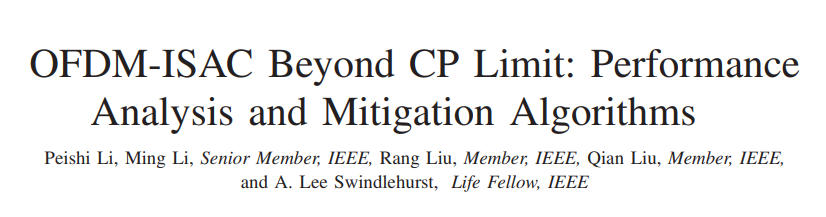
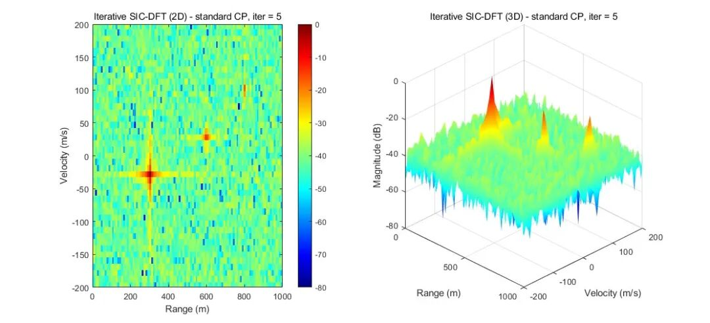
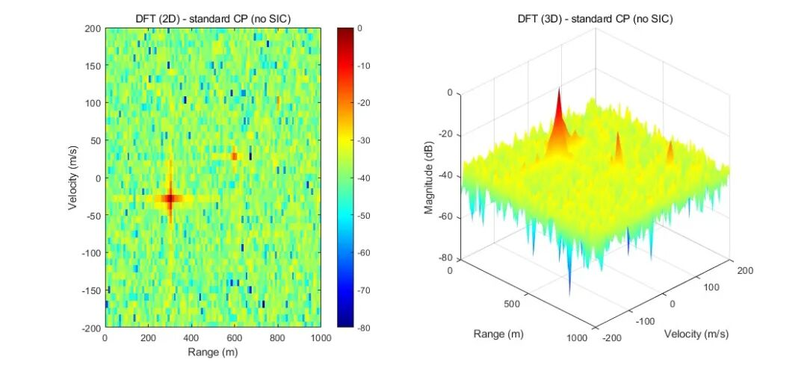
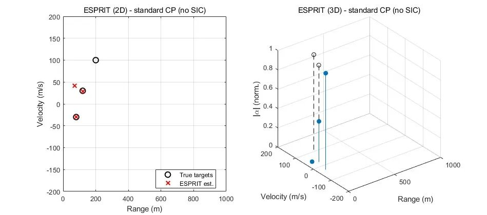
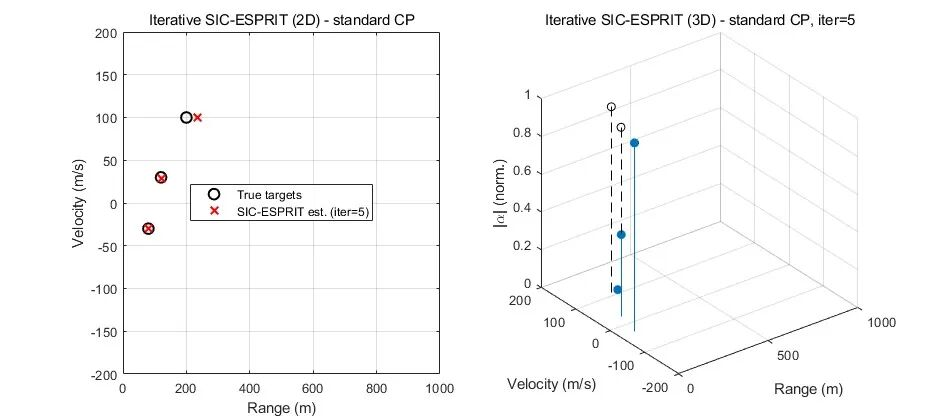

# ISAC Breakthrough: Overcoming CP Bottlenecks with OFDM-ISAC for Long-Range Perception: SINR + 4dB, RMSE Dropped by a Logarithmic Scale

Personal Blog: https://www.cnblogs.com/EWFrontier  
Beyond CP Limits of OFDM-ISAC: Performance Analysis and Mitigation Algorithms ✿  
1. Article Title: Beyond CP Limits of OFDM-ISAC: Performance Analysis and Mitigation Algorithms  
(Original: OFDM-ISAC Beyond CP Limit: Performance Analysis and Mitigation Algorithms)  
2. Abstract: Orthogonal Frequency Division Multiplexing (OFDM) is highly suitable for integrated perception and communication (ISAC), but its cyclic prefix (CP) is designed for communication-level multipath, often insufficient to meet perception needs. When echoes exceed the CP duration, intersymbol interference (ISI) and carrier-to-interference ratio (ICI) can destroy subcarrier orthogonality, leading to a degradation in perception performance. This paper proposes a unified analysis and algorithm framework for OFDM-ISAC beyond CP limits: firstly, a general echo model is established, clearly capturing the structural coupling relationship between ISI and ICI caused by CP deficiency; based on this model, closed-form expressions for perception signal-to-interference-plus-noise ratio (SINR) and distance-Doppler peak sidelobe ratio (PSLR) are derived, showing that both degrade approximately linearly with normalized excess delay outside the CP; to mitigate these effects, two compatible standard serial interference cancellation (SIC) methods are proposed—a low-complexity DFT-based scheme (SIC-DFT) and an oversampled subspace method (SIC-ESPRIT). Simulation validation demonstrates the effectiveness of the analysis, with both algorithms outperforming mainstream benchmarks: under scenarios with insufficient CP, SINR improvement exceeds 4dB; SIC-ESPRIT reduces the root mean square error (RMSE) of distance/speed by about an order of magnitude, achieving performance close to systems with sufficient CP length. The research findings provide theoretical support and practical solutions for reliable long-distance OFDM-ISAC perception beyond CP limits.
Introduction: Integrated Sensor and Communications (ISAC) has become a key enabling technology for next-generation wireless systems, integrating traditionally separate radar and communication networks into a unified multifunctional platform [1]-[3]. By jointly utilizing spectrum resources, hardware architectures, and advanced signal processing techniques, ISAC significantly enhances spectral efficiency and system integration, empowering emerging applications such as autonomous driving, intelligent manufacturing, and environmental perception wireless connectivity [4],[5]. Among various waveform candidates, Orthogonal Frequency Division Multiplexing (OFDM) has attracted widespread attention due to its extensive application in modern wireless standards (such as 5G NR, Wi-Fi 6/7), as well as its inherent advantages in ISAC scenarios (e.g., efficient delay-Doppler separation estimation [6],[7], flexible time-frequency resource allocation [8],[9], low sidelobes at short distances [10],[11]).
Based on OFDM-based ISAC systems face a fundamental constraint: the cyclic prefix (CP) was originally designed for communication systems to combat symbol intersymbol interference (ISI) caused by multipath propagation. The CP duration of communication systems is designed based on microsecond-level time delay spread, which usually meets wireless channel requirements, but radar perception requires handling echoes from kilometers away, meaning that the round trip delay is significantly longer. Therefore, echoes beyond the CP duration inevitably cause ISI and carrier-to-interference (CII). For example, under normal CP configuration in 5G NR with subcarrier spacing of 120kHz, the standard CP duration is only 0.59μs, theoretically allowing no interference perception distance of about 90 meters [12]. Thus, actual ISAC systems must operate reliably beyond the CP limit, while their perception requirements are fundamentally different from those of communication standards.
In recent years, studies have explored the impact of CP deficiency on OFDM perception performance [13]-[17]. These analyses indicate that when the target echo exceeds the CP duration, significant ISI and ICI occur, leading to an increase in sidelobe levels in the distance-Doppler diagram (RDM), significantly degrading parameter estimation accuracy [13], [14], [15]. Unlike communication systems, radar perception heavily relies on the accumulation of coherent signals between subcarriers and symbols. Therefore, it is more sensitive to structured interference than in communication systems, where moderate ISI can typically be mitigated through equalization. However, existing theoretical analyses often simplify ISI/ICI modeling by assuming interference and uninterfused components are statistically independent or using Gaussian approximations, which reduces analysis precision and fails to capture the inherent structurally coupled characteristics of ISI/ICI components in OFDM perception scenarios. Therefore, a rigorous and accurate performance characterization method is urgently needed for OFDM-ISAC systems that exceed CP limitations.

Beyond performance characterization, recent research has also explored methods to alleviate CP deficiency, mainly divided into two categories: transmitter waveform design and receiver compensation: transmitter methods (such as modifying the CP structure [15], [18], [19], redesigning the pilot pattern [20], and optimizing symbol-level waveforms) can effectively suppress ISI/ICI but often sacrifice spectral efficiency and deviate from standardized OFDM formats; receiver methods (such as time domain coherent compensation (TDCC) [13], [14], virtual CP reconstruction [22], frequency domain coherent compensation (FDCC) [23], multi-objective coherent compensation (MTCC) [23]) enhance the uninterfused signal component through coherent compensation but simultaneously amplify noise and residual interference, failing to completely eliminate ISI/ICI. Therefore, there is still a lack of effective mitigation algorithms that can fully counteract interference compatible with standard OFDM signal formats.

Given these key gaps, this paper constructs a unified analysis and algorithm framework for OFDM-ISAC perception beyond CP limitations, covering signal modeling, theoretical analysis, and interference suppression algorithms. The main contributions are as follows:
A general OFDM-ISAC echo model has been established, clarifying the structural coupling relationship between ISI and ICI caused by CP deficiency. It reveals how CP deficiency can destroy the distance-Doppler separable structure and introduce coherent interference between subcarriers and OFDM symbols, providing a foundation for theoretical performance analysis and algorithm design.
2
Closed-form analytical expressions for perceived SINR and distance-Doppler PSLR have been derived, without making assumptions about the independence or Gaussianity of the interference terms. Analysis shows that both SINR degradation and sidelobe elevation increase approximately linearly with normalized excess delay outside the CP, providing quantitative evidence for the trade-off between CP length and perception performance.
3
Two frequency domain interference cancellation algorithms (SIC-DFT and SIC-ESPRIT) have been proposed to alleviate ISI and ICI caused by CP deficiency: SIC-DFT employs a low-complexity DFT basis estimation, while SIC-ESPRIT utilizes subspace basis parameter recovery to achieve super-resolution perception accuracy. Both methods are fully compatible with standard OFDM signals and do not require waveform modifications.
4
Numerical simulations have validated the correctness of the theoretical analysis and the effectiveness of the algorithms: both SIC-DFT and SIC-ESPRIT outperform existing benchmark schemes, achieving an SINR improvement of over 4dB in scenarios with insufficient CP; SIC-ESPRIT estimates exhibit superior precision, reducing the RMSE of distance and speed by an order of magnitude compared to competitors, approaching the performance of systems with sufficient CP. The research results confirm that the proposed framework can achieve reliable and high-fidelity OFDM-ISAC perception beyond the limitations of CP.
4. Conclusion This paper proposes a unified analytical and algorithmic framework for OFDM-based integrated perception and communication (ISAC) systems that operate beyond the constraints of cyclic prefix (CP). It first establishes a general echo model, clearly representing the structural coupling relationship between CP deficiency and inter-symbol interference (ISI), as well as inter-carrier interference (ICI). Based on this model, closed-form expressions for perception signal-to-interference-plus-noise ratio (SINR) and distance-Doppler peak sidelobe ratio (PSLR) are derived. Analysis indicates that both SINR degradation and sidelobe elevation increase approximately linearly with normalized excess delay outside the CP. To mitigate these effects, two iterative interference cancellation algorithms (SIC-DFT and SIC-ESPRIT) are proposed. Simulation results validate the accuracy of the analytical expressions and demonstrate that the proposed algorithms significantly outperform existing benchmark solutions. The outcomes of this study provide theoretical insights and practical techniques for reliable long-range OFDM-ISAC perception beyond CP constraints.

## Images

<!-- PAYMENT_BLOCK -->

## Get this dataset

- Payment link (Stripe): [Buy now](https://buy.stripe.com/3cs8yP7sY87d0vu9AB)
- Payment QR code: 

<!-- /PAYMENT_BLOCK -->
